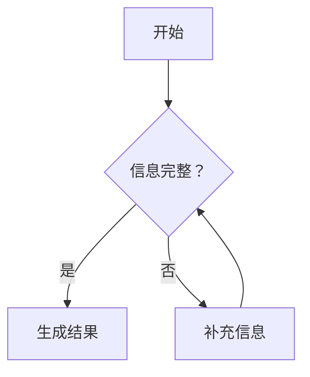
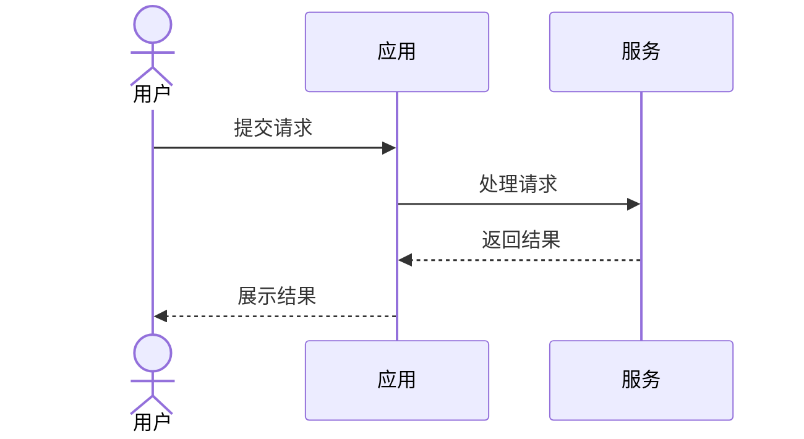
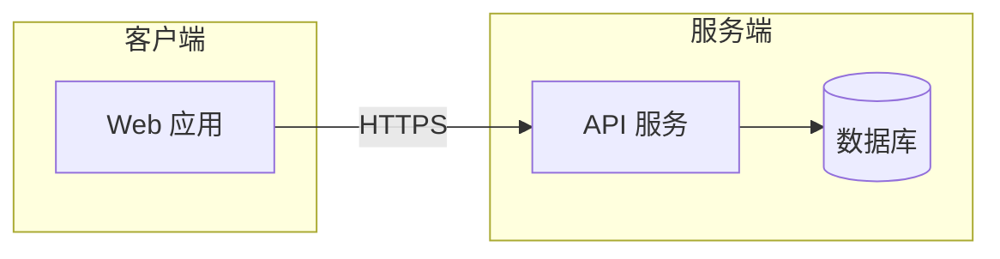

# Pele 参考

仅在需要选择图型、查询语法差异或调整主题时读取本文件。

## 图型速查

Pele 支持 Mermaid 12.1.0 内置的图型，但使用自己的布局与视觉风格。

| 表达目的 | Mermaid 起始关键字 |
| --- | --- |
| 流程、决策、依赖 | `flowchart` 或 `graph` |
| 泳道流程 | `swimlane-beta` |
| 消息调用顺序 | `sequenceDiagram` |
| 类与继承 | `classDiagram` |
| 状态迁移 | `stateDiagram-v2` |
| 实体与数据关系 | `erDiagram` |
| 日程与工期 | `gantt` |
| Git 分支历史 | `gitGraph` |
| 占比 | `pie` |
| 层级想法 | `mindmap` |
| 任务看板 | `kanban` |
| 事件时间线 | `timeline` |
| 用户体验过程 | `journey` |
| 象限分析 | `quadrantChart` |
| 柱状图、折线图 | `xychart` |
| 需求追踪 | `requirementDiagram` |
| 流量分配 | `sankey-beta` |
| 系统架构 | `architecture-beta` |
| C4 架构 | `C4Context`、`C4Container`、`C4Component`、`C4Dynamic`、`C4Deployment` |
| 块状布局 | `block-beta` |
| Agent 工作流 | `agentflow-beta` |
| 树状文件结构 | `treeView-beta` |
| 数据包结构 | `packet-beta` |
| 雷达图 | `radar-beta` |
| 矩形树图 | `treemap-beta` |
| 韦恩图 | `venn-beta` |
| 鱼骨图 | `ishikawa-beta` |

完整示例见 <https://pele.run/examples>。遇到这里没有覆盖的图型时，查官方示例后再写源码。

## 常用骨架

### 流程图



### 时序图



### 架构关系



## Pele 与 Mermaid 的关键差异

- Pele 面向 Mermaid 12.1.0 语法；ZenUML 等外部插件不在支持范围内。
- 布局、节点位置、间距和连线路径由 Pele 自己计算，与 Mermaid.js 不完全相同。
- 标签支持文本、换行、粗体和斜体；复杂排版使用多个简洁标签表达。
- Mermaid 主题不会直接生效；通用配色使用下文的 CSS 变量。
- `style`、`classDef` 中写死的颜色不会随主题切换。
- 数学公式需要应用提供排版器；随附脚本保留 TeX 源文本。
- 随附脚本默认关闭外部链接和图片，避免打开 SVG 时产生网络请求；确有需要时使用 `--allow-external`。

官方兼容性说明见 <https://pele.run/compatibility>。

## 主题

先用渲染器的 `--css <文件>` 注入主题。CSS 以 `.pele` 为作用域：

```css
.pele {
  --pele-bg: #fffcf0;
  --pele-fg: #100f0f;
  --pele-muted: #6f6e69;
  --pele-line: #100f0f;
  --pele-surface: #f2f0e5;
  --pele-surface-alt: #e6e4d9;
  --pele-border: #cecdc3;
  --pele-accent: #205ea6;
  --pele-critical: #af3029;
  --pele-radius: 4px;
}
```

常用变量：

| 变量 | 用途 |
| --- | --- |
| `--pele-bg` | 背景 |
| `--pele-fg` | 正文与标签 |
| `--pele-muted` | 次要文字 |
| `--pele-line` | 连线与箭头 |
| `--pele-surface` | 节点填充 |
| `--pele-surface-alt` | 分组填充 |
| `--pele-border` | 边框 |
| `--pele-accent` | 强调色 |
| `--pele-series-1` 至 `--pele-series-8` | 图表系列颜色 |
| `--pele-font` | 正文字体 |
| `--pele-font-mono` | 等宽文字字体 |

使用自定义字体时，同时向脚本传入相同的 `--font-family`，让文字测量与最终显示一致。完整主题文档见 <https://pele.run/theming>，渲染 API 见 <https://pele.run/api>。
