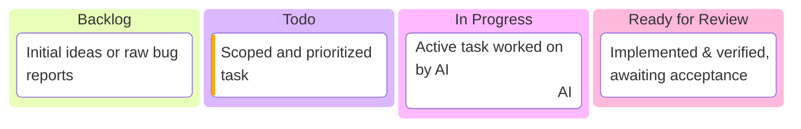

# manage-project-kanban 技能指南

本技能定义了一套基于 **Mermaid Kanban 纯文本** 记录项目进展的敏捷研发工作流。

让日常软件开发像在轻量看板中协同一样直观自然：遇到问题提 Issue、排期进入看板、AI 读取看板接单开发、自测完成提交待验收，最终验收通过后归档移出。

---

## 一、 核心设计哲学（第一性原理）

1. **待验收即是看板的终点**：
   实时看板只记录“正在流转”的高价值任务。**绝不在看板中堆积已完成（Done）卡片**，避免看板变成沉重的垃圾堆。
2. **验收通过必须物理移出**：
   一旦用户确认验收通过（Accepted），AI 必须将该卡片从 Mermaid 看板中**物理删除**，并转移记录到项目根目录或 `.workflow/history.md` 的归档历史中。
3. **文本即数据，画板即呈现**：
   - **对 AI**：直接读写 `board.html` 中的 Mermaid 纯文本（`<script type="text/mermaid" id="kanban-source">`），0 额外格式开销；
   - **对人类**：浏览器直接打开 `board.html`，通过 Pele (SVG) 呈现出高阶暗黑、无框舒展、可交互缩放的极简画板。
4. **极致极简，去装饰化**：
   画板界面不堆砌“规范”、“历史”等冗余按钮与弹窗，顶栏仅保留纯粹的品牌标题，让用户的全部注意力聚焦在正在进行的任务流上。

---

## 二、 语言自适应与看板四大泳道

**AI 应根据用户的语言使用习惯，决定 HTML 页面与 Mermaid 泳道的语言**：

### 1. 中文习惯（默认推荐）
- 页面 Title 与左上角标题：`项目看板`
- 四大标准泳道：
```mermaid
kanban
  backlog[待处理]
    feat001[原始想法 / 待细化分解的 Bug]
  todo[待开发]
    feat002[目标已明确、排期待做]@{ priority: "High" }
  in_progress[进行中]
    work003[AI 正在攻坚的任务 (WIP 限制)]@{ assigned: "AI" }
  ready_for_review[待验收]
    docs004[开发与自测就绪，等待人类最终验收]
```

### 2. 英文习惯
- 页面 Title 与左上角标题：`Project Kanban`
- 四大标准泳道：


| 泳道定位 | 职责说明 | 准入准出 |
| :--- | :--- | :--- |
| **待处理 (`Backlog`)** | 原始议题 / 灵感记录 | 人类或 AI 提出了新点子、临时 Bug；方案清晰后移入待开发。 |
| **待开发 (`Todo`)** | 排期待做 / 目标明确 | 已明确方案与优先级 (`@{ priority: "High/Medium/Low" }`)；开始开发前移入进行中。 |
| **进行中 (`In Progress`)** | 攻坚执行中 | AI 正在编写代码与自测（**WIP 限制：同时仅能进行 1 项**）。 |
| **待验收 (`Ready for Review`)** | **看板终点** | 交付物已就绪；用户确认验收后，**物理移出看板，归档至历史**。 |

---

## 三、 AI 标准操作规范（SOP）

AI 在维护看板时，必须遵循以下标准动作：

### 1. 发现新问题或记录新想法（入库）
- 为新需求分配唯一卡片 ID（格式为 `id[标题]`，可通过 `@{ priority: "High" }` 附加属性）；
- 追加放入需求池或待开发泳道。

### 2. 认领任务并开始开发（接单）
- 从待开发泳道选定优先级最高的任务；
- 将其完整行从待开发剪切挪入进行中泳道；
- 添加 `@{ assigned: "AI" }` 属性；
- **自律原则**：进行中泳道严格只允许存在 1 个正在攻坚的任务，避免并发上下文发散。

### 3. 完成开发与本地自测（送审）
- 编写完业务代码并跑通本地测试；
- 将卡片从进行中剪切挪入待验收泳道；
- 在对话中向人类汇报：“任务 `[XXX]` 已开发完毕并就绪，请验收”。

### 4. 验收通过与归档移出（终极归档）
- 当人类回复“验收通过”、“确认”、“OK”或满意结果时：
  1. **物理删除**：直接使用 `edit` 工具将该卡片从 `board.html` 的 Mermaid 代码中整段删掉；
  2. **沉淀历史**：将该卡片内容、完成时间、改动文件追加记录至项目根目录的 `history.md`：
     ```markdown
     ### [FEAT-006] 国际化多语言支持
     - **完成时间**: 2025-10-30
     - **验收结论**: 人类验收通过，功能就绪
     - **主要改动**: `src/locales/zh.json`, `src/locales/en.json`
     ```

---

## 四、 本地画板极速预览与 HMR（热重载）

当用户需要打开可视化画板时，AI 可提示或协助运行：

```bash
# 利用套件自带的 Bun 运行环境，拉起 Vite 热重载服务
.runtime/bin/bun x vite
```

- 启动后浏览器访问输出的本地地址（如 `http://localhost:5173/board.html`）
- AI 后续每次通过文件工具修改 `board.html` 中的 Mermaid 内容，浏览器里的 SVG 看板卡片会实时自动重绘
